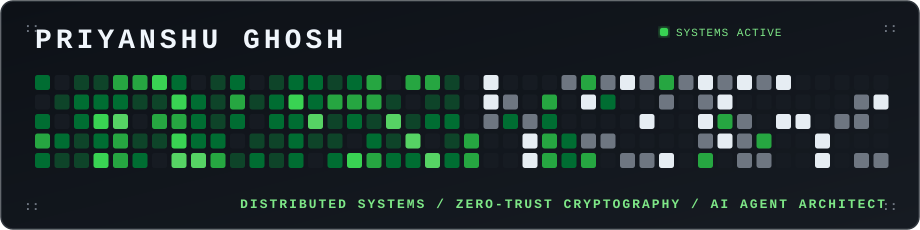
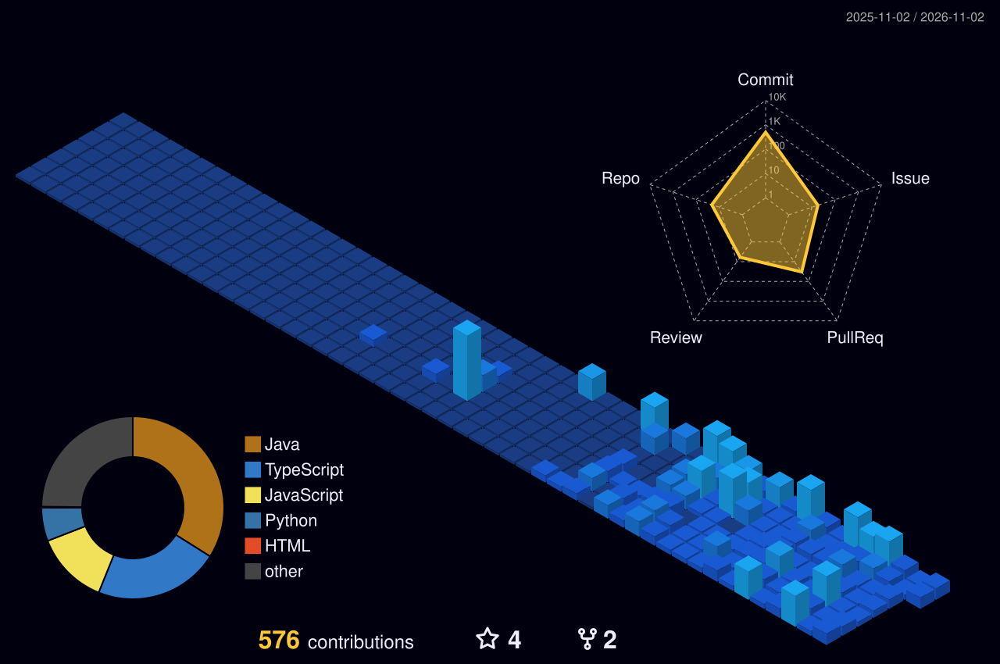
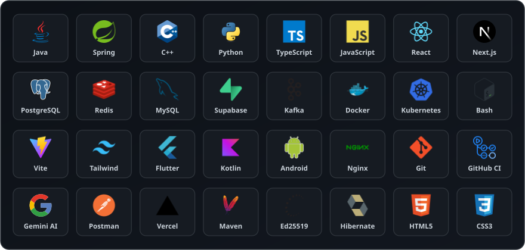

<div align="center">

<!-- ══════════════════════════════════════════════════════════════════ -->
<!--  HEADER BANNER (Retro Pixel Matrix // Neo-Terminal Aesthetic)       -->
<!-- ══════════════════════════════════════════════════════════════════ -->



<br/><br/>

<!-- ══════════════════════════════════════════════════════════════════ -->
<!--  TYPING TELEMETRY                                                 -->
<!-- ══════════════════════════════════════════════════════════════════ -->


<br/>

<!-- ══════════════════════════════════════════════════════════════════ -->
<!--  HIGH-CONTRAST METRIC PILLS                                       -->
<!-- ══════════════════════════════════════════════════════════════════ -->

<a href="#production-systems-architecture"></a>
&nbsp;
<a href="https://triagenet-frontend.onrender.com"></a>
&nbsp;
<a href="#zerohour"></a>
&nbsp;
<a href="#verified-honors--track-record"></a>
&nbsp;
<a href="#triagenet-v130"></a>

</div>

<br/>

<!-- ══════════════════════════════════════════════════════════════════ -->
<!--  EDITORIAL IDENTITY SECTION (WHO I AM // WHAT I DO // VISION)      -->
<!-- ══════════════════════════════════════════════════════════════════ -->

### WHO I AM &nbsp; 

Hey, I'm **Priyanshu** — a Jharkhand-based AI Engineer & Full Stack Engineer obsessed with building high-throughput distributed backends, zero-trust security architectures, and autonomous multi-agent systems. I work at the intersection of high-concurrency Java microservices, modern reactive frontends, and applied AI agents, and I write about what I build and learn from first principles.

### WHAT I DO &nbsp; 

I build production-grade distributed architectures, high-performance backends, and state-wide dispatch platforms that solve real-world emergency infrastructure problems. Obsessed with high velocity (shipped full multi-agent platforms in 24 hours), 100% automated test suites (89/89 tests green), and zero-compromise systems design.

### VISION &nbsp; 

My goal is to design resilient computational foundations that push digital infrastructure further ahead than it was yesterday. Whether routing emergency ambulances during the golden hour ([TriageNet](https://github.com/PG300604/TriageNet)) or orchestrating high-concurrency distributed microservices ([ShopFlow](https://github.com/PG300604/ShopFLow)), technology must serve humanity with mathematical precision and unwavering reliability. **Humanity first, technology second.**

### BEYOND CODE &nbsp; 

Competitive algorithmic problem solving ([LeetCode](https://leetcode.com/u/priyanshughosh30/)), exploring cryptographic protocols & distributed consensus, listening to ambient electronic & synth soundscapes, and thinking from first principles — that's me outside of production code.

<br/>

<!-- ══════════════════════════════════════════════════════════════════ -->
<!--  SOCIAL MATRIX (FRAMED TERMINAL GRID)                              -->
<!-- ══════════════════════════════════════════════════════════════════ -->

<div align="center">

<table align="center" width="100%" style="border-collapse: collapse; border: 1px solid #30363d; background: #0d1117;">
  <thead>
    <tr style="border-bottom: 1px solid #30363d;">
      <th align="center" width="8%" style="color: #6e7681; font-family: monospace;">::</th>
      <th align="center" width="14%" style="color: #c9d1d9; font-family: monospace; font-size: 13px;">LinkedIn</th>
      <th align="center" width="14%" style="color: #c9d1d9; font-family: monospace; font-size: 13px;">Portfolio</th>
      <th align="center" width="14%" style="color: #c9d1d9; font-family: monospace; font-size: 13px;">Gmail</th>
      <th align="center" width="14%" style="color: #c9d1d9; font-family: monospace; font-size: 13px;">GitHub</th>
      <th align="center" width="14%" style="color: #c9d1d9; font-family: monospace; font-size: 13px;">LeetCode</th>
      <th align="center" width="14%" style="color: #c9d1d9; font-family: monospace; font-size: 13px;">X (Twitter)</th>
      <th align="center" width="8%" style="color: #6e7681; font-family: monospace;">::</th>
    </tr>
  </thead>
  <tbody>
    <tr>
      <td align="center" style="color: #39d353; font-family: monospace; font-size: 16px;">[::]</td>
      <td align="center" style="padding: 12px 6px;">
        <a href="https://www.linkedin.com/in/priyanshu-ghosh-/"></a>
      </td>
      <td align="center" style="padding: 12px 6px;">
        <a href="https://shipwithpriyanshu.vercel.app/"></a>
      </td>
      <td align="center" style="padding: 12px 6px;">
        <a href="mailto:priyanshughosh97@gmail.com"></a>
      </td>
      <td align="center" style="padding: 12px 6px;">
        <a href="https://github.com/PG300604"></a>
      </td>
      <td align="center" style="padding: 12px 6px;">
        <a href="https://leetcode.com/u/priyanshughosh30/"></a>
      </td>
      <td align="center" style="padding: 12px 6px;">
        <a href="https://x.com/PGhosh3006"></a>
      </td>
      <td align="center" style="color: #39d353; font-family: monospace; font-size: 16px;">[::]</td>
    </tr>
  </tbody>
</table>

</div>

<br/>

<!-- ══════════════════════════════════════════════════════════════════ -->
<!--  3D ISOMETRIC CONTRIBUTION SKYLINE & TELEMETRY                     -->
<!-- ══════════════════════════════════════════════════════════════════ -->

### ENGINEERING METRICS & 3D SKYLINE &nbsp; 

<div align="center">

<picture>
  <source media="(prefers-color-scheme: dark)" srcset="./profile-3d-contrib/profile-night-view.svg" />
  <source media="(prefers-color-scheme: light)" srcset="./profile-3d-contrib/profile-green-animate.svg" />
  
</picture>

<br/><br/>


&nbsp;&nbsp;


<br/><br/>


</div>

<br/>

<!-- ══════════════════════════════════════════════════════════════════ -->
<!--  SKILL SET (4x8 = 32 CUSTOM DARK TILES GRID)                       -->
<!-- ══════════════════════════════════════════════════════════════════ -->

### SKILL SET &nbsp; 

<div align="center">



<br/><br/>

| Domain | Core Competencies & Toolchain |
|:---|:---|
| **Backend & Microservices** | Java 21/17 · Spring Boot 3.3.13 · Spring Cloud Gateway · Spring Security · Hibernate/JPA · Maven · Virtual Threads |
| **Security & Cryptography** | Ed25519 (RFC 8032) · Streaming SHA-256 · SunEC JCA · Signature-Pinned Baselines · Quartz Schedulers |
| **Distributed Architecture** | Netflix Eureka Discovery · 2-Phase Stock Reservation Locks · Redis 7.2 Sub-50ms Pub/Sub · OpenFeign RPC |
| **Applied AI & Agent Swarms** | Gemini Multimodal API · Autonomous Agent Teams (Planner/Prioritizer/Scheduler/Nudge) · Sigmoid Acuity Logistic Regression · SSE Streaming |
| **Databases & Spatial GIS** | PostgreSQL 16 + PostGIS Spatial Engine · Redis 7.2 AOF In-Memory Broker · MySQL · Supabase · H2 · HikariCP |
| **Frontend & Mobile UI** | React 19/18 · Next.js 16.4.1 (Turbopack, SSR) · TypeScript 5.7 · Vite · Tailwind CSS v4 · Leaflet 3D · Flutter · Kotlin · Jetpack Compose |
| **DevOps, Security & Cloud** | Docker Compose · Render Cloud · Nginx Reverse Proxy · Aqua Trivy (0 CVEs) · GitHub Actions CI/CD · Vercel · Railway |

</div>

<br/>

<!-- ══════════════════════════════════════════════════════════════════ -->
<!--  DEPLOYMENT STATUS MONITOR                                         -->
<!-- ══════════════════════════════════════════════════════════════════ -->

### DEPLOYMENT STATUS MONITOR &nbsp; 

<div align="center">

```
┌────────────────────────────────────────────────────────────────────────────────────────┐
│  [::]  ENTERPRISE SYSTEMS & CLOUD PRODUCTION MONITOR                 [ STATUS: GREEN ] │
├─────────────────────────┬──────────────┬─────────────────────────────┬─────────────────┤
│  SERVICE / SYSTEM       │  STATUS      │  CORE ARCHITECTURE          │  DEPLOYMENT     │
├─────────────────────────┼──────────────┼─────────────────────────────┼─────────────────┤
│  TriageNet Platform     │  v1.3.0 LIVE │  Java 17 · Next 16 · Redis  │  Render Cloud   │
│  ShopFlow Mesh          │  SHIPPED     │  8 Microservices · 2PC Lock │  Docker Cloud   │
│  ZeroHour AI            │  SHIPPED     │  Gemini AI · 4-Agent SSE    │  Firebase / Rwy │
│  RepoMind Analyzer      │  SUBMITTED   │  IBM Bob API · GitHub Bot   │  IBM Hackathon  │
│  SkyCheck PWA           │  SUBMITTED   │  Dexie.js · Edge Vision PWA │  Tata InnoVent  │
│  SkillShare             │  LIVE        │  Haversine Geo · Docker     │  Vercel Cloud   │
├─────────────────────────┼──────────────┼─────────────────────────────┼─────────────────┤
│  SHIPPED SYSTEMS: 7+    │  CI: 100%    │  ACTIVE REPOSITORIES: 10+   │  INTERNSHIP: YES│
└─────────────────────────┴──────────────┴─────────────────────────────┴─────────────────┘
```

</div>

<br/>

<!-- ══════════════════════════════════════════════════════════════════ -->
<!--  EXPANDABLE PROJECT CARDS WITH CONCISE BEAUTY PANELS               -->
<!-- ══════════════════════════════════════════════════════════════════ -->

### PRODUCTION SYSTEMS ARCHITECTURE &nbsp; 

<!-- ─── 1. TriageNet ─── -->

<details open id="triagenet-v130">
<summary>
  <b>TriageNet v1.3.0</b> &nbsp;|&nbsp; <code>PRODUCTION LIVE</code> &nbsp;|&nbsp; <code>111 Hospitals</code> &nbsp;|&nbsp; <code>89/89 Tests Green</code>
  <br/>
  <sub>Statewide Emergency Healthcare Operating System & 108 Ambulance Dispatch Platform</sub>
</summary>

<br/>

<table width="100%" style="border-collapse: collapse; border: 1px solid #30363d; background: #0d1117;">
  <tr>
    <td style="padding: 14px 18px; border-left: 4px solid #39d353;">
      <b>Purpose:</b> Statewide healthcare emergency OS connecting <b>111 real government hospitals across all 24 districts of Jharkhand</b> (RIMS Ranchi, MGM Jamshedpur, SNMMCH Dhanbad, 24 District Hospitals, 80+ CHCs) to automate emergency triage, specialist bed matching, and highway corridor dispatch.
      <br/><br/>
      <b>Key Metrics:</b>
      <br/>
      • <b>111 authentic hospitals</b> across <b>24 districts</b> mapped with real distance matrices<br/>
      • <b>89/89 automated tests passing</b> (100% CI Green on Linux & Windows runners)<br/>
      • <b>Sub-50ms latency</b> on Redis 7.2 GPS ambulance telemetry streaming<br/>
      • <b>98.88% emergency acuity recall</b> validated across 4 Kaggle hospital datasets<br/>
      • <b>0 security vulnerabilities</b> verified by Aqua Trivy container scans
      <br/><br/>
      <b>Problem Solved:</b> Prevents golden-hour trauma fatalities caused by manual phone-based bed inquiries, ambulance transit gridlock, and lack of real-time ICU specialist matching.
      <br/><br/>
      <b>How It Differs:</b> Implements <b>4 hand-crafted native Java algorithmic engines</b>: multivariate logistic acuity scoring, lock-free wait-aging priority ($E = S + \lambda\sqrt{W}$), Kuhn-Munkres $O(V^3)$ bipartite ICU bed allocation, and Dijkstra shortest-path routing integrated with municipal <b>ITMS 108 Green Wave traffic signal preemption</b>—running zero external Python or solver runtime overhead.
      <br/><br/>
      <b>Stack:</b> Java 17 · Spring Boot 3.3.13 · Next.js 16.4.1 · Redis 7.2 · PostgreSQL 16 + PostGIS · Docker Compose · Nginx
      <br/><br/>
      <b>Direct Links:</b> &nbsp;
      <a href="https://triagenet-frontend.onrender.com"></a>
      &nbsp;
      <a href="https://github.com/PG300604/TriageNet/releases/tag/v1.3.0"></a>
      &nbsp;
      <a href="https://github.com/PG300604/TriageNet"></a>
    </td>
  </tr>
</table>

</details>

<br/>

<!-- ─── 2. ShopFlow ─── -->

<details id="shopflow">
<summary>
  <b>ShopFlow</b> &nbsp;|&nbsp; <code>SHIPPED v1.0</code> &nbsp;|&nbsp; <code>8 Microservices</code> &nbsp;|&nbsp; <code>Solo Architecture</code>
  <br/>
  <sub>Distributed Multi-Vendor Commerce Platform with Two-Phase Stock Reservation</sub>
</summary>

<br/>

<table width="100%" style="border-collapse: collapse; border: 1px solid #30363d; background: #0d1117;">
  <tr>
    <td style="padding: 14px 18px; border-left: 4px solid #f0883e;">
      <b>Purpose:</b> Multi-vendor distributed commerce mesh engineered independently to eliminate inventory race conditions and overselling during high-concurrency checkouts.
      <br/><br/>
      <b>Key Metrics:</b>
      <br/>
      • <b>8 Spring Boot 3.3 microservices</b> engineered solo from ground up<br/>
      • <b>Two-phase reservation locks</b> preventing duplicate sales on the final unit<br/>
      • <b>60-second background auto-sweeper</b> releasing abandoned stock holds after <b>15 minutes</b><br/>
      • <b>Netflix Eureka discovery</b> (<code>:8761</code>) with Spring Cloud Gateway JWT claims forwarding
      <br/><br/>
      <b>Problem Solved:</b> Flash sales trigger severe distributed race conditions, causing inventory overselling and orphaned stock holds when checkouts are abandoned midway.
      <br/><br/>
      <b>How It Differs:</b> Replaces single-table database locks with a distributed <b>Two-Phase Stock Reservation state machine</b> (<code>PENDING</code> $\rightarrow$ <code>COMMITTED</code> / <code>RELEASED</code>), automated background sweeper daemons, Stripe Card/UPI HMAC webhooks, and a Pinterest-inspired React 18 storefront.
      <br/><br/>
      <b>Stack:</b> Java 17 · Spring Boot 3.3 · Spring Cloud · PostgreSQL · React 18 · TypeScript · Vite · Stripe · Docker
      <br/><br/>
      <b>Direct Links:</b> &nbsp;
      <a href="https://github.com/PG300604/ShopFLow/blob/main/docs/SYSTEM_DOCUMENTATION.md"></a>
      &nbsp;
      <a href="https://github.com/PG300604/ShopFLow"></a>
    </td>
  </tr>
</table>

</details>

<br/>

<!-- ─── 3. ZeroHour ─── -->

<details id="zerohour">
<summary>
  <b>ZeroHour</b> &nbsp;|&nbsp; <code>PRODUCTION LIVE</code> &nbsp;|&nbsp; <code>Shipped in 24h</code> &nbsp;|&nbsp; <code>Google Vibe2Ship</code>
  <br/>
  <sub>Autonomous Multi-Agent AI Crisis Scheduling Companion & Productivity Engine</sub>
</summary>

<br/>

<table width="100%" style="border-collapse: collapse; border: 1px solid #30363d; background: #0d1117;">
  <tr>
    <td style="padding: 14px 18px; border-left: 4px solid #39d353;">
      <b>Purpose:</b> Autonomous multi-agent crisis companion built and deployed end-to-end in <b>24 hours</b> at CodingNinjas × Google Hackathon, transforming chaotic stacked deadlines into executable calendars.
      <br/><br/>
      <b>Key Metrics:</b>
      <br/>
      • <b>Shipped in 24 hours</b> end-to-end at national hackathon<br/>
      • <b>4 coordinated autonomous AI agents</b> working in an orchestration pipeline<br/>
      • <b>Real-time Server-Sent Events (SSE)</b> streaming thought chains directly to UI<br/>
      • <b>Multimodal document parsing</b> via Gemini API with automatic Google Calendar slot allocation
      <br/><br/>
      <b>Problem Solved:</b> Resolves student and professional deadline anxiety and paralysis when confronting multiple sudden deadlines across unstructured files (syllabi, PDFs, photos).
      <br/><br/>
      <b>How It Differs:</b> Replaces passive checklists and single LLM prompts with a <b>4-agent swarm</b> (<code>Planner</code> $\rightarrow$ <code>Prioritizer</code> $\rightarrow$ <code>Scheduler`</code> $\rightarrow$ <code>Nudge</code>) that reasons live in-browser via SSE and synchronizes schedule slots into Google Calendar with automated deadline nudge alerts.
      <br/><br/>
      <b>Stack:</b> React · Spring Boot · Gemini Multimodal API · Google Calendar API · Firebase · Railway · SSE
      <br/><br/>
      <b>Direct Links:</b> &nbsp;
      <a href="https://zerohour-a84d3.web.app/"></a>
      &nbsp;
      <a href="https://github.com/PG300604/ZeroHour"></a>
    </td>
  </tr>
</table>

</details>

<br/>

<!-- ─── 4. RepoMind ─── -->

<details id="repomind">
<summary>
  <b>RepoMind</b> &nbsp;|&nbsp; <code>HACKATHON SUBMITTED</code> &nbsp;|&nbsp; <code>IBM Bob 2.0</code> &nbsp;|&nbsp; <code>GitHub Action Bot</code>
  <br/>
  <sub>Whole-Repository AI Pull Request Blast-Radius & Merge Risk Analyzer</sub>
</summary>

<br/>

<table width="100%" style="border-collapse: collapse; border: 1px solid #30363d; background: #0d1117;">
  <tr>
    <td style="padding: 14px 18px; border-left: 4px solid #58a6ff;">
      <b>Purpose:</b> Code review co-pilot that reasons across the entire repository graph — rather than merely staged diff lines — to detect downstream regressions and risk before merge.
      <br/><br/>
      <b>Key Metrics:</b>
      <br/>
      • <b>IBM Bob 2.0 Hackathon submission</b><br/>
      • <b>Zero-touch CI integration</b> via drop-in <code>.github/workflows</code> Action<br/>
      • <b>3-tier automated risk scoring</b> (Low / Medium / High) with plain-language blast-radius explanations<br/>
      • <b>Auto-generated test stub suggestions</b> for code paths uncovered by the diff
      <br/><br/>
      <b>Problem Solved:</b> Code reviewers evaluate pull requests in isolation, missing breaking changes introduced into downstream services or dependent function calls.
      <br/><br/>
      <b>How It Differs:</b> Connects IBM Bob's semantic code reasoning with an automated GitHub Action to trace the full abstract dependency graph across the entire repo, posting risk summaries and concrete JUnit test stubs directly as PR comments.
      <br/><br/>
      <b>Stack:</b> Java 17 · Spring Boot 3 · IBM Bob API · GitHub Actions
      <br/><br/>
      <b>Direct Links:</b> &nbsp;
      <a href="https://github.com/PG300604/REPOMIND-IBM_BOB2.0_HACKATHON_PROJ"></a>
    </td>
  </tr>
</table>

</details>

<br/>

<!-- ─── 5. SkyCheck ─── -->

<details id="skycheck">
<summary>
  <b>SkyCheck</b> &nbsp;|&nbsp; <code>INNOVENT SUBMISSION</code> &nbsp;|&nbsp; <code>Offline-First PWA</code> &nbsp;|&nbsp; <code>Tata InnoVent 2026</code>
  <br/>
  <sub>Offline-First Edge AI Visual Structural Inspection Progressive Web Application</sub>
</summary>

<br/>

<table width="100%" style="border-collapse: collapse; border: 1px solid #30363d; background: #0d1117;">
  <tr>
    <td style="padding: 14px 18px; border-left: 4px solid #f0883e;">
      <b>Purpose:</b> Offline-first industrial safety audit PWA allowing field inspectors to perform real-time structural defect audits in remote zones with zero internet connectivity.
      <br/><br/>
      <b>Key Metrics:</b>
      <br/>
      • <b>Tata Technologies InnoVent submission</b><br/>
      • <b>Real-time in-browser edge inference</b> on live camera feeds<br/>
      • <b>Zero network dependency</b> during field operations<br/>
      • <b>Dexie.js IndexedDB storage</b> with cascading ID reconciliation to cloud PostgreSQL
      <br/><br/>
      <b>Problem Solved:</b> Field engineers inspecting high-voltage power lines, bridges, and pipelines often work in zero-connectivity areas where cloud AI tools fail.
      <br/><br/>
      <b>How It Differs:</b> Executes computer vision classification on camera feeds entirely inside the browser to detect corrosion and micro-cracks. Data is stored locally in IndexedDB, automatically syncing with PostgreSQL when internet connectivity returns.
      <br/><br/>
      <b>Stack:</b> React PWA · Dexie.js · Gemini Vision API · Spring Boot · PostgreSQL · Tailwind CSS
      <br/><br/>
      <b>Direct Links:</b> &nbsp;
      <a href="https://dist-five-gules-45.vercel.app/"></a>
      &nbsp;
      <a href="https://github.com/PG300604/SkyCheck"></a>
    </td>
  </tr>
</table>

</details>

<br/>

<!-- ─── 6. SkillShare ─── -->

<details id="skillshare">
<summary>
  <b>SkillShare</b> &nbsp;|&nbsp; <code>LIVE DEPLOYED</code> &nbsp;|&nbsp; <code>Haversine Geolocation</code> &nbsp;|&nbsp; <code>Docker Alpine</code>
  <br/>
  <sub>Hyper-Local Collaborative Skill Matching Platform with Dynamic Proximity Discovery</sub>
</summary>

<br/>

<table width="100%" style="border-collapse: collapse; border: 1px solid #30363d; background: #0d1117;">
  <tr>
    <td style="padding: 14px 18px; border-left: 4px solid #39d353;">
      <b>Purpose:</b> Hyper-local peer skill exchange application matching builders, designers, and developers based on geographic proximity and complementary skill sets.
      <br/><br/>
      <b>Key Metrics:</b>
      <br/>
      • <b>Production deployment</b> live on Vercel and containerized environments<br/>
      • <b>10km to 100km dynamic Haversine radius expansion</b> when local density is low<br/>
      • <b>Multi-stage Docker Alpine build</b> with optimized JRE runtime footprint<br/>
      • <b>OAuth2 + JWT authentication</b> via JWKS verification
      <br/><br/>
      <b>Problem Solved:</b> Online learning platforms lack local physical accountability, while local meetups lack targeted matchmaking based on verified technical proficiencies.
      <br/><br/>
      <b>How It Differs:</b> Combines a native Haversine spatial calculation algorithm with dynamic geographic radius expansion and proficiency score fallbacks for intuitive collaborator matching.
      <br/><br/>
      <b>Stack:</b> Java · Spring Boot · Spring Security · React 19 · PostgreSQL · Docker · Vercel
      <br/><br/>
      <b>Direct Links:</b> &nbsp;
      <a href="https://skillshare-app-vercel-xv9i.vercel.app/"></a>
      &nbsp;
      <a href="https://github.com/PG300604/skillshare-app-vercel"></a>
    </td>
  </tr>
</table>

</details>

<br/>

<!-- ══════════════════════════════════════════════════════════════════ -->
<!--  VERIFIED ACHIEVEMENTS & TRACK RECORD                              -->
<!-- ══════════════════════════════════════════════════════════════════ -->

### VERIFIED HONORS & TRACK RECORD &nbsp; 

<div align="center">

| Achievement / Milestone | Organization / Event | Engineering Impact | Year |
|:---|:---|:---|:---:|
| **TriageNet Production Launch (v1.3.0)** | Public Health Cloud | 111 government hospitals across 24 districts · 89/89 test suites (100% CI Green) · Live on Render Cloud · 0 Trivy CVEs | 2026 |
| **ShopFlow 8-Microservices Solo Ship** | Independent Build | Engineered 8 Spring Boot microservices solo · Two-phase inventory reservation state machine · Stripe card & UPI integration | 2026 |
| **IBM Bob 2.0 Hackathon** | IBM | RepoMind submitted: PR blast-radius risk analyzer with full repository dependency reasoning & auto GitHub Action bot | 2026 |
| **24-Hour Hackathon Ship** | CodingNinjas × Google | Built + deployed ZeroHour (multi-agent AI app) in 24 hours end-to-end | 2026 |
| **Tata Technologies InnoVent** | Tata Technologies | SkyCheck PWA: Edge AI defect inspection with offline IndexedDB sync submitted | 2026 |
| **Software Engineering Simulation** | JPMorgan Chase (Forage) | Kafka event streaming · REST API integration · H2 database architecture | 2026 |
| **Academic Standing (SGPA 8.83 · CGPA 8.05)** | Asansol Engineering College | B.Tech CSBS (Computer Science & Business Systems) | 2027 |

</div>

<br/>

<!-- ══════════════════════════════════════════════════════════════════ -->
<!--  WHY HIRE ME // CORE ADVANTAGES                                    -->
<!-- ══════════════════════════════════════════════════════════════════ -->

### CORE ENGINEERING ADVANTAGES &nbsp; 

<div align="center">

| Advantage | Tangible Evidence Across Shipped Code |
|:---|:---|
| **Zero-to-Ship Velocity** | Shipped a full multi-agent crisis app in **24 hours** (ZeroHour) and engineered **8 microservices solo** (ShopFlow) with zero shortcuts. |
| **Security-First Architecture** | Proven track record in Ed25519 cryptography, 22-vector security audits with HttpOnly JWTs, and **0 Trivy CVEs** (TriageNet). |
| **Distributed Systems Depth** | Hands-on mastery of two-phase inventory reservation locks, Netflix Eureka discovery meshes, and Redis 7.2 sub-50ms distributed pub/sub & TTL locks. |
| **100% Test-Driven Reliability** | **89/89 tests** on TriageNet · 100% green CI testing with rigorous edge-case coverage and automated verification. |

</div>

<br/>

<!-- ══════════════════════════════════════════════════════════════════ -->
<!--  GROWTH HORIZON (2026-2027)                                        -->
<!-- ══════════════════════════════════════════════════════════════════ -->

### TECHNICAL HORIZON (2026–2027) &nbsp; 

<div align="center">

| Focus Domain | High-Impact Milestones & Toolchain |
|:---|:---|
| **High-Throughput Streaming** | Deepening event-driven architectures with **Apache Kafka**, partition rebalancing, and CDC (Debezium). |
| **Autonomous Agent Orchestration** | Production agent networks using **Model Context Protocol (MCP)**, multi-agent consensus, and structured tool calling. |
| **Cloud-Native Infrastructure** | Hardened container deployments with **Kubernetes (K8s)**, Helm charts, and GraalVM AOT native compilation. |

</div>

<br/>

<!-- ══════════════════════════════════════════════════════════════════ -->
<!--  CONTRIBUTION SNAKE ANIMATION                                      -->
<!-- ══════════════════════════════════════════════════════════════════ -->

### CONTRIBUTION ACTIVITY &nbsp; 

<div align="center">

<picture>
  <source media="(prefers-color-scheme: dark)" srcset="https://raw.githubusercontent.com/PG300604/PG300604/output/github-contribution-grid-snake-dark.svg" />
  <source media="(prefers-color-scheme: light)" srcset="https://raw.githubusercontent.com/PG300604/PG300604/output/github-contribution-grid-snake.svg" />
  
</picture>

</div>

<br/>

<!-- ══════════════════════════════════════════════════════════════════ -->
<!--  FOOTER                                                            -->
<!-- ══════════════════════════════════════════════════════════════════ -->

<div align="center">


<br/><br/>

<a href="https://shipwithpriyanshu.vercel.app/"></a>
&nbsp;
<a href="https://www.linkedin.com/in/priyanshu-ghosh-/"></a>
&nbsp;
<a href="mailto:priyanshughosh97@gmail.com"></a>
&nbsp;
<a href="https://leetcode.com/u/priyanshughosh30/"></a>
&nbsp;
<a href="https://x.com/PGhosh3006"></a>

<br/><br/>

```
"Code is read far more often than it is written. Build with mathematical rigor, ship with audacity."
```

<br/>


</div>
