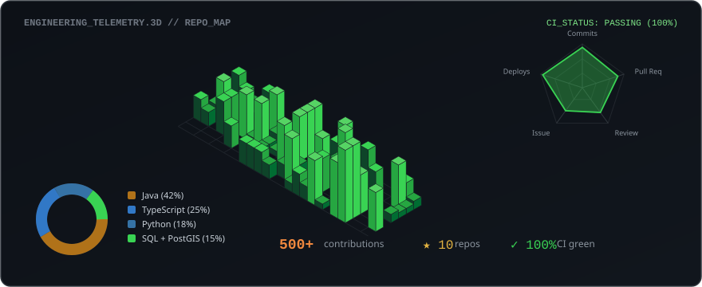

<div align="center">

<!-- ══════════════════════════════════════════════════════════════════ -->
<!--  HEADER BANNER (Retro Pixel Matrix // Neo-Terminal Aesthetic)       -->
<!-- ══════════════════════════════════════════════════════════════════ -->


<br/><br/>

<!-- ══════════════════════════════════════════════════════════════════ -->
<!--  TYPING TELEMETRY                                                 -->
<!-- ══════════════════════════════════════════════════════════════════ -->


<br/>

<!-- ══════════════════════════════════════════════════════════════════ -->
<!--  HIGH-CONTRAST METRIC PILLS                                       -->
<!-- ══════════════════════════════════════════════════════════════════ -->

<a href="#-flagship-systems-architecture"></a>
&nbsp;
<a href="https://triagenet-frontend.onrender.com"></a>
&nbsp;
<a href="#-zerohour--multi-agent-crisis-companion-shipped-in-24-hours"></a>
&nbsp;
<a href="#-verified-honors--track-record"></a>
&nbsp;
<a href="#-hashwatch--cryptographically-signed-file-integrity-monitoring-fyp-lead"></a>

</div>

<br/>

<!-- ══════════════════════════════════════════════════════════════════ -->
<!--  EDITORIAL IDENTITY SECTION (WHO I AM // WHAT I DO // VISION)      -->
<!-- ══════════════════════════════════════════════════════════════════ -->

### WHO I AM &nbsp; 

Hey, I'm **Priyanshu** — a West Bengal-based Systems & AI Engineer obsessed with building high-throughput distributed backends, zero-trust cryptographic security, and autonomous multi-agent systems. I work at the intersection of high-concurrency Java microservices, modern reactive frontends, and applied AI agents, and I write about what I build and learn from first principles.

### WHAT I DO &nbsp; 

I build production-grade distributed architectures, zero-trust cryptographic baselines (Ed25519 asymmetric signatures & streaming SHA-256), and state-wide dispatch platforms that solve real-world emergency infrastructure problems. Obsessed with high velocity (shipped full multi-agent platforms in 24 hours), 100% automated test suites (89/89 tests green), and zero-compromise systems design.

### VISION &nbsp; 

My goal is to design resilient computational foundations that push digital infrastructure further ahead than it was yesterday. Whether routing emergency ambulances during the golden hour ([TriageNet](https://github.com/PG300604/TriageNet)) or sealing enterprise file systems against silent tampering ([HashWatch](https://github.com/PG300604/HashWatch)), technology must serve humanity with mathematical precision and unwavering reliability. **Humanity first, technology second.**

### BEYOND CODE &nbsp; 

Competitive algorithmic problem solving ([LeetCode](https://github.com/PG300604/LeetCode-Solutions)), exploring cryptographic protocols & distributed consensus, listening to ambient electronic & synth soundscapes, and thinking from first principles — that's me outside of production code.

<br/>

<!-- ══════════════════════════════════════════════════════════════════ -->
<!--  SOCIAL MATRIX (FRAMED TERMINAL GRID)                              -->
<!-- ══════════════════════════════════════════════════════════════════ -->

<div align="center">

<table align="center" width="100%" style="border-collapse: collapse; border: 1px solid #30363d; background: #0d1117;">
  <thead>
    <tr style="border-bottom: 1px solid #30363d;">
      <th align="center" width="8%" style="color: #6e7681; font-family: monospace;">::</th>
      <th align="center" width="14%" style="color: #c9d1d9; font-family: monospace; font-size: 13px;">LinkedIn</th>
      <th align="center" width="14%" style="color: #c9d1d9; font-family: monospace; font-size: 13px;">Portfolio</th>
      <th align="center" width="14%" style="color: #c9d1d9; font-family: monospace; font-size: 13px;">Gmail</th>
      <th align="center" width="14%" style="color: #c9d1d9; font-family: monospace; font-size: 13px;">GitHub</th>
      <th align="center" width="14%" style="color: #c9d1d9; font-family: monospace; font-size: 13px;">LeetCode</th>
      <th align="center" width="14%" style="color: #c9d1d9; font-family: monospace; font-size: 13px;">X (Twitter)</th>
      <th align="center" width="8%" style="color: #6e7681; font-family: monospace;">::</th>
    </tr>
  </thead>
  <tbody>
    <tr>
      <td align="center" style="color: #39d353; font-family: monospace; font-size: 16px;">[::]</td>
      <td align="center" style="padding: 12px 6px;">
        <a href="https://www.linkedin.com/in/priyanshu-ghosh-pg3006/"></a>
      </td>
      <td align="center" style="padding: 12px 6px;">
        <a href="https://shipwithpriyanshu.vercel.app/"></a>
      </td>
      <td align="center" style="padding: 12px 6px;">
        <a href="mailto:priyanshu.ghosh.dev@gmail.com"></a>
      </td>
      <td align="center" style="padding: 12px 6px;">
        <a href="https://github.com/PG300604"></a>
      </td>
      <td align="center" style="padding: 12px 6px;">
        <a href="https://github.com/PG300604/LeetCode-Solutions"></a>
      </td>
      <td align="center" style="padding: 12px 6px;">
        <a href="https://x.com/"></a>
      </td>
      <td align="center" style="color: #39d353; font-family: monospace; font-size: 16px;">[::]</td>
    </tr>
  </tbody>
</table>

</div>

<br/>

<!-- ══════════════════════════════════════════════════════════════════ -->
<!--  3D ISOMETRIC CONTRIBUTION SKYLINE & TELEMETRY                     -->
<!-- ══════════════════════════════════════════════════════════════════ -->

### ENGINEERING METRICS & 3D SKYLINE &nbsp; 

<div align="center">



<br/><br/>


&nbsp;&nbsp;


<br/><br/>


</div>

<br/>

<!-- ══════════════════════════════════════════════════════════════════ -->
<!--  SKILL SET (4x8 = 32 CUSTOM DARK TILES GRID)                       -->
<!-- ══════════════════════════════════════════════════════════════════ -->

### SKILL SET &nbsp; 

<div align="center">


<br/><br/>

| Domain | Core Competencies & Toolchain |
|:---|:---|
| **Backend & Microservices** | Java 21/17 · Spring Boot 3.3.13 · Spring Cloud Gateway · Spring Security · Hibernate/JPA · Maven · Virtual Threads |
| **Zero-Trust Cryptography** | Ed25519 (RFC 8032) · Streaming SHA-256 (64 KB Chunks) · SunEC JCA · Signature-Pinned Baselines · Quartz Scheduler |
| **Distributed Architecture** | Netflix Eureka Discovery · 2-Phase Stock Reservation Locks · Redis 7.2 Sub-50ms Pub/Sub · OpenFeign RPC |
| **Applied AI & Agent Swarms** | Gemini Multimodal API · Autonomous Agent Teams (Planner/Prioritizer/Scheduler/Nudge) · Sigmoid Acuity Logistic Regression · SSE Streaming |
| **Databases & Spatial GIS** | PostgreSQL 16 + PostGIS Spatial Engine · Redis 7.2 AOF In-Memory Broker · MySQL · Supabase · H2 · HikariCP |
| **Frontend & Mobile UI** | React 19/18 · Next.js 16.4.1 (Turbopack, SSR) · TypeScript 5.7 · Vite · Tailwind CSS v4 · Leaflet 3D · Flutter · Kotlin · Jetpack Compose |
| **DevOps, Security & Cloud** | Docker Compose · Render Cloud · Nginx Reverse Proxy · Aqua Trivy (0 CVEs) · GitHub Actions CI/CD · Vercel · Railway |

</div>

<br/>

<!-- ══════════════════════════════════════════════════════════════════ -->
<!--  DEPLOYMENT STATUS MONITOR                                         -->
<!-- ══════════════════════════════════════════════════════════════════ -->

### DEPLOYMENT STATUS MONITOR &nbsp; 

<div align="center">

```
┌────────────────────────────────────────────────────────────────────────────────────────┐
│  ◉  ENTERPRISE SYSTEMS & CLOUD PRODUCTION MONITOR                    [ STATUS: GREEN ] │
├─────────────────────────┬──────────────┬─────────────────────────────┬─────────────────┤
│  SERVICE / SYSTEM       │  STATUS      │  CORE ARCHITECTURE          │  DEPLOYMENT     │
├─────────────────────────┼──────────────┼─────────────────────────────┼─────────────────┤
│  TriageNet Platform     │  ● v1.3.0    │  Java 17 · Next 16 · Redis  │  Live on Render │
│  HashWatch FIM          │  ● SPRINT 2  │  Ed25519 · SHA-256 · Quartz │  Lead Final Yr  │
│  ShopFlow Mesh          │  ● SHIPPED   │  8 Microservices · 2PC Lock │  v1.0 Live      │
│  ZeroHour AI            │  ● SHIPPED   │  Gemini AI · Multi-Agent    │  24-Hr Ship     │
│  RepoMind Analyzer      │  ● SUBMITTED │  IBM Bob API · CI Action    │  IBM Hackathon  │
│  SkyCheck PWA           │  ● SUBMITTED │  Dexie.js · Edge Vision PWA │  Tata InnoVent  │
│  SkillShare             │  ● LIVE      │  Haversine Geo · Docker     │  Live on Vercel │
├─────────────────────────┼──────────────┼─────────────────────────────┼─────────────────┤
│  SHIPPED SYSTEMS: 8     │  CI: 100%    │  ACTIVE REPOSITORIES: 10+   │  INTERNSHIP: YES│
└─────────────────────────┴──────────────┴─────────────────────────────┴─────────────────┘
```

</div>

<br/>

<!-- ══════════════════════════════════════════════════════════════════ -->
<!--  EXPANDABLE PROJECT CARDS WITH BEAUTY PANELS                       -->
<!-- ══════════════════════════════════════════════════════════════════ -->

### 🚀 FLAGSHIP SYSTEMS ARCHITECTURE &nbsp; 

<!-- ─── 1. TriageNet ─── -->

<details open>
<summary>
  <b>◆ TriageNet v1.3.0</b> &nbsp;
   &nbsp;
   &nbsp;
  
  <br/>
  <sub><i>Statewide AI-Powered Emergency Healthcare OS, 108 Ambulance Dispatch & Spatial Resource Allocation Platform</i></sub>
</summary>

<br/>

<table width="100%" style="border-collapse: collapse; border: 1px solid #30363d; background: #0d1117;">
  <tr>
    <td style="padding: 14px 18px; border-left: 4px solid #39d353;">
      <b>🎯 Purpose:</b> A state-wide healthcare emergency operating system interconnecting <b>111 real government hospitals across all 24 districts of Jharkhand</b> (RIMS Ranchi, MGM Jamshedpur, SNMMCH Dhanbad, 24 District Hospitals, and 80+ CHCs) to automate emergency triage, specialist bed matching, and corridor traffic preemption during the golden hour.
      <br/><br/>
      <b>📊 Key Metrics:</b> <code>111 Government Hospitals</code> · <code>24 Districts Covered</code> · <code>89/89 Tests Passing (100% CI Green)</code> · <code>Sub-50ms Redis 7.2 Telemetry</code> · <code>98.88% Emergency Acuity Recall</code> · <code>Aqua Trivy 0 CVEs</code>
      <br/><br/>
      <b>🌍 Real-World Problem Solved:</b> Critical trauma and sepsis patients frequently face fatal delays due to manual phone-based bed inquiries, ambulance traffic congestion, and mismatched ICU sub-specializations.
      <br/><br/>
      <b>⚡ How It Differs:</b> Unlike passive hospital directories or third-party black-box tools, TriageNet implements <b>4 hand-crafted native Java algorithmic engines</b>: multivariate logistic acuity scoring, lock-free wait-aging queue priority ($E = S + \lambda\sqrt{W}$), Kuhn-Munkres $O(V^3)$ bipartite ICU bed allocation, and Dijkstra shortest-path routing integrated with municipal <b>ITMS 108 Green Wave traffic signal preemption</b> along national highway corridors.
      <br/><br/>
      <b>🔗 Quick Access:</b> &nbsp;
      <a href="https://triagenet-frontend.onrender.com"></a>
      &nbsp;
      <a href="https://github.com/PG300604/TriageNet/releases/tag/v1.3.0"></a>
      &nbsp;
      <a href="https://github.com/PG300604/TriageNet"></a>
    </td>
  </tr>
</table>

</details>

<br/>

<!-- ─── 2. HashWatch ─── -->

<details>
<summary>
  <b>◆ HashWatch</b> &nbsp;
   &nbsp;
   &nbsp;
  
  <br/>
  <sub><i>Cryptographically Signed File Integrity & Baseline Monitoring System (Final Year Project Lead)</i></sub>
</summary>

<br/>

<table width="100%" style="border-collapse: collapse; border: 1px solid #30363d; background: #0d1117;">
  <tr>
    <td style="padding: 14px 18px; border-left: 4px solid #58a6ff;">
      <b>🎯 Purpose:</b> An enterprise-grade File Integrity Monitoring (FIM) system engineered to guarantee absolute data authenticity across critical file systems under zero-trust assumptions.
      <br/><br/>
      <b>📊 Key Metrics:</b> <code>33/33 Tests Passing</code> · <code>&lt;64 KB RAM Consumption</code> (64 KB chunked streaming SHA-256) · <code>30s Resilient Quartz Polling</code> · <code>0% Storage Bloat</code> · <code>Dual-Profile Persistence (H2 / PostgreSQL 16)</code>
      <br/><br/>
      <b>🌍 Real-World Problem Solved:</b> Traditional FIM solutions (Tripwire, AIDE) store hash baselines in plain databases. When an attacker achieves root or database-level access, they execute <b>Baseline Poisoning Attacks</b> — modifying unauthorized files and rewriting the database hashes to silently mask the intrusion.
      <br/><br/>
      <b>⚡ How It Differs:</b> HashWatch implements <b>native Edwards-curve digital signatures (Ed25519 via SunEC JCA RFC 8032)</b> with a Canonical Triple-Lock Envelope (Domain + Path + Hash + Size) and active public-key fingerprint pinning. Any unauthorized modification to the database baselines immediately trips a deterministic <code>SIGNATURE_INVALID</code> alert state, mathematically isolating disk tampering from database tampering.
      <br/><br/>
      <b>🔗 Quick Access:</b> &nbsp;
      <a href="https://github.com/PG300604/HashWatch"></a>
      &nbsp;
      <a href="https://github.com/PG300604/HashWatch#readme"></a>
    </td>
  </tr>
</table>

</details>

<br/>

<!-- ─── 3. ShopFlow ─── -->

<details>
<summary>
  <b>◆ ShopFlow</b> &nbsp;
   &nbsp;
   &nbsp;
  
  <br/>
  <sub><i>Distributed Multi-Vendor Microservices Commerce Platform with Two-Phase Stock Reservation</i></sub>
</summary>

<br/>

<table width="100%" style="border-collapse: collapse; border: 1px solid #30363d; background: #0d1117;">
  <tr>
    <td style="padding: 14px 18px; border-left: 4px solid #f0883e;">
      <b>🎯 Purpose:</b> An end-to-end, multi-vendor distributed commerce mesh engineered from the ground up to solve inventory race conditions during high-concurrency checkouts.
      <br/><br/>
      <b>📊 Key Metrics:</b> <code>8 Spring Boot 3.3 Microservices</code> · <code>100% Solo Architecture</code> · <code>60-Second Auto-Sweeper Worker</code> · <code>15-Minute Abandonment TTL Hold</code> · <code>Netflix Eureka Discovery (:8761)</code>
      <br/><br/>
      <b>🌍 Real-World Problem Solved:</b> Flash sales and concurrent shopping carts trigger severe distributed race conditions, leading to inventory overselling or ghost stock locks when payments are abandoned.
      <br/><br/>
      <b>⚡ How It Differs:</b> Implements a distributed <b>Two-Phase Stock Reservation state machine</b> (<code>PENDING</code> $\rightarrow$ <code>COMMITTED</code> / <code>RELEASED</code>) with an automated background sweeper daemon, embedded Stripe Card/UPI payment modal with HMAC cryptographic webhook validation, Netflix Eureka discovery mesh, Spring Cloud Gateway claims forwarding, and an editorial Pinterest-inspired React 18 UI.
      <br/><br/>
      <b>🔗 Quick Access:</b> &nbsp;
      <a href="https://github.com/PG300604/ShopFLow/blob/main/docs/SYSTEM_DOCUMENTATION.md"></a>
      &nbsp;
      <a href="https://github.com/PG300604/ShopFLow"></a>
    </td>
  </tr>
</table>

</details>

<br/>

<!-- ─── 4. ZeroHour ─── -->

<details>
<summary>
  <b>◆ ZeroHour</b> &nbsp;
   &nbsp;
   &nbsp;
  
  <br/>
  <sub><i>Autonomous Multi-Agent AI Crisis Productivity Companion & Deadline Scheduler</i></sub>
</summary>

<br/>

<table width="100%" style="border-collapse: collapse; border: 1px solid #30363d; background: #0d1117;">
  <tr>
    <td style="padding: 14px 18px; border-left: 4px solid #39d353;">
      <b>🎯 Purpose:</b> An autonomous multi-agent crisis companion built and deployed end-to-end in 24 hours at the CodingNinjas × Google Hackathon, transforming chaotic stacked deadlines into executable calendars.
      <br/><br/>
      <b>📊 Key Metrics:</b> <code>Shipped in 24 Hours</code> · <code>4 Coordinated AI Agents</code> · <code>Real-Time SSE Agent Streaming</code> · <code>Multimodal Document Parsing</code> · <code>Google Calendar & Gmail Sync</code>
      <br/><br/>
      <b>🌍 Real-World Problem Solved:</b> Students and knowledge workers confront overwhelming paralysis when hit with sudden, simultaneous deadlines spread across disjointed syllabi, photos, and project briefs.
      <br/><br/>
      <b>⚡ How It Differs:</b> Replaces static to-do apps and single-turn chatbots with a coordinated <b>4-agent pipeline</b> (<code>PlannerAgent</code> $\rightarrow$ <code>PrioritizerAgent</code> $\rightarrow$ <code>SchedulerAgent</code> $\rightarrow$ <code>NudgeAgent</code>). Users watch the agents reason live in the browser via Server-Sent Events (SSE) as they parse multimodal files and automatically push schedule slots to Google Calendar.
      <br/><br/>
      <b>🔗 Quick Access:</b> &nbsp;
      <a href="https://zerohour-a84d3.web.app/"></a>
      &nbsp;
      <a href="https://github.com/PG300604/ZeroHour"></a>
    </td>
  </tr>
</table>

</details>

<br/>

<!-- ─── 5. RepoMind ─── -->

<details>
<summary>
  <b>◆ RepoMind</b> &nbsp;
   &nbsp;
   &nbsp;
  
  <br/>
  <sub><i>Whole-Repository AI Pull Request Blast-Radius & Merge Risk Analyzer (IBM Bob 2.0 Hackathon)</i></sub>
</summary>

<br/>

<table width="100%" style="border-collapse: collapse; border: 1px solid #30363d; background: #0d1117;">
  <tr>
    <td style="padding: 14px 18px; border-left: 4px solid #58a6ff;">
      <b>🎯 Purpose:</b> A code review co-pilot designed for engineering teams that reasons across the entire repository graph — rather than merely the staged git diff — to catch hidden regression risks.
      <br/><br/>
      <b>📊 Key Metrics:</b> <code>IBM Bob 2.0 Hackathon Submission</code> · <code>Zero-Touch CI Integration</code> · <code>3-Tier Risk Classification</code> · <code>Downstream Dependency Mapping</code>
      <br/><br/>
      <b>🌍 Real-World Problem Solved:</b> Code reviewers judge pull requests by reading isolated patches, frequently missing breaking changes introduced into distant dependent services or unhandled edge cases.
      <br/><br/>
      <b>⚡ How It Differs:</b> Combines IBM Bob's semantic code reasoning with a drop-in GitHub Actions workflow. On every pull request open or sync, RepoMind automatically maps the full blast radius, scores merge risk, and suggests concrete JUnit/integration test stubs directly as a PR comment with zero human intervention required.
      <br/><br/>
      <b>🔗 Quick Access:</b> &nbsp;
      <a href="https://github.com/PG300604/REPOMIND-IBM_BOB2.0_HACKATHON_PROJ"></a>
    </td>
  </tr>
</table>

</details>

<br/>

<!-- ─── 6. SkyCheck ─── -->

<details>
<summary>
  <b>◆ SkyCheck</b> &nbsp;
   &nbsp;
   &nbsp;
  
  <br/>
  <sub><i>Offline-First Edge AI Visual Structural Inspection Progressive Web Application</i></sub>
</summary>

<br/>

<table width="100%" style="border-collapse: collapse; border: 1px solid #30363d; background: #0d1117;">
  <tr>
    <td style="padding: 14px 18px; border-left: 4px solid #f0883e;">
      <b>🎯 Purpose:</b> An offline-first industrial PWA built for infrastructure safety audits, enabling field inspectors to detect and log structural defects in remote environments with zero network connectivity.
      <br/><br/>
      <b>📊 Key Metrics:</b> <code>Tata Technologies InnoVent Submission</code> · <code>Real-Time In-Browser Edge Inference</code> · <code>Zero Network Dependency</code> · <code>Dexie.js IndexedDB Store</code> · <code>PostgreSQL Cascading Sync</code>
      <br/><br/>
      <b>🌍 Real-World Problem Solved:</b> Field engineers inspecting high-voltage power transmission lines, pipeline joints, and bridges often work in rural areas with zero cellular reception, making cloud-dependent AI inspection systems unusable.
      <br/><br/>
      <b>⚡ How It Differs:</b> Performs real-time computer vision inference directly on live camera feeds inside the browser to identify corrosion, fissures, and surface wear. All audit records and imagery are persisted locally via IndexedDB (Dexie.js), automatically reconciling and syncing with the central PostgreSQL backend once internet connectivity is restored.
      <br/><br/>
      <b>🔗 Quick Access:</b> &nbsp;
      <a href="https://dist-five-gules-45.vercel.app/"></a>
      &nbsp;
      <a href="https://github.com/PG300604/SkyCheck"></a>
    </td>
  </tr>
</table>

</details>

<br/>

<!-- ─── 7. SkillShare ─── -->

<details>
<summary>
  <b>◆ SkillShare</b> &nbsp;
   &nbsp;
   &nbsp;
  
  <br/>
  <sub><i>Hyper-Local Collaborative Skill Matching Platform with Custom Geolocation Radius Engine</i></sub>
</summary>

<br/>

<table width="100%" style="border-collapse: collapse; border: 1px solid #30363d; background: #0d1117;">
  <tr>
    <td style="padding: 14px 18px; border-left: 4px solid #39d353;">
      <b>🎯 Purpose:</b> A peer skill exchange application matching builders, designers, and engineers based on geographic proximity and complementary skill sets.
      <br/><br/>
      <b>📊 Key Metrics:</b> <code>Live on Vercel</code> · <code>10km $\rightarrow$ 100km Dynamic Haversine Radius Expansion</code> · <code>Multi-Stage Docker Alpine Container</code> · <code>OAuth2 + JWT via JWKS</code>
      <br/><br/>
      <b>🌍 Real-World Problem Solved:</b> Online learning communities remain purely virtual (lacking local accountability), while local meetups lack targeted matchmaking based on verified technical proficiencies.
      <br/><br/>
      <b>⚡ How It Differs:</b> Combines a native Haversine geolocation calculation algorithm with dynamic geographic radius expansion (expanding from 10km to 100km automatically when local density is low) and top-proficiency score ranking fallbacks, packaged in a multi-stage Alpine JRE container.
      <br/><br/>
      <b>🔗 Quick Access:</b> &nbsp;
      <a href="https://skillshare-app-vercel-xv9i.vercel.app/"></a>
      &nbsp;
      <a href="https://github.com/PG300604/skillshare-app-vercel"></a>
    </td>
  </tr>
</table>

</details>

<br/>

<!-- ══════════════════════════════════════════════════════════════════ -->
<!--  VERIFIED ACHIEVEMENTS & TRACK RECORD                              -->
<!-- ══════════════════════════════════════════════════════════════════ -->

### 🏆 VERIFIED HONORS & TRACK RECORD &nbsp; 

<div align="center">

| Achievement / Milestone | Organization / Event | Engineering Impact | Year |
|:---|:---|:---|:---:|
| **TriageNet Production Launch (v1.3.0)** | Public Health Cloud | 111 government hospitals across 24 districts · 89/89 test suites (100% CI Green) · Live on Render Cloud · 0 Trivy CVEs | 2026 |
| **HashWatch Project Lead** | Academic Research FYP | Architected Zero-Trust FIM system with Ed25519 digital signatures & 64 KB streaming SHA-256 · 33/33 test suites passing | 2026 |
| **ShopFlow 8-Microservices Solo Ship** | Independent Build | Engineered 8 Spring Boot microservices solo · Two-phase inventory reservation state machine · Stripe card & UPI integration | 2026 |
| **IBM Bob 2.0 Hackathon** | IBM | RepoMind submitted: PR blast-radius risk analyzer with full repository dependency reasoning & auto GitHub Action bot | 2026 |
| **24-Hour Hackathon Ship** | CodingNinjas × Google | Built + deployed ZeroHour (multi-agent AI app) in 24 hours end-to-end | 2026 |
| **Tata Technologies InnoVent** | Tata Technologies | SkyCheck PWA: Edge AI defect inspection with offline IndexedDB sync submitted | 2026 |
| **Software Engineering Simulation** | JPMorgan Chase (Forage) | Kafka event streaming · REST API integration · H2 database architecture | 2026 |
| **Academic Standing (SGPA 8.83 · CGPA 8.05)** | Asansol Engineering College | B.Tech CSBS (Computer Science & Business Systems) | 2027 |

</div>

<br/>

<!-- ══════════════════════════════════════════════════════════════════ -->
<!--  WHY HIRE ME // CORE ADVANTAGES                                    -->
<!-- ══════════════════════════════════════════════════════════════════ -->

### 💡 CORE ENGINEERING ADVANTAGES &nbsp; 

<div align="center">

| Advantage | Tangible Evidence Across Shipped Code |
|:---|:---|
| ⚡ **Extreme Zero-to-Ship Velocity** | Shipped a full multi-agent crisis app in **24 hours** (ZeroHour) and engineered **8 microservices solo** (ShopFlow) with zero shortcuts. |
| 🛡️ **Zero-Trust Security Discipline** | Proven track record in Ed25519 cryptography (HashWatch), 22-vector security audits with HttpOnly JWTs, and **0 Trivy CVEs** (TriageNet). |
| 🏗️ **Distributed Systems Depth** | Hands-on mastery of two-phase inventory reservation locks, Netflix Eureka discovery meshes, and Redis 7.2 sub-50ms distributed pub/sub & TTL locks. |
| 🧪 **100% Test-Driven Reliability** | **33/33** tests on HashWatch · **89/89** tests on TriageNet · 100% green CI testing with edge-case mathematical proofs. |

</div>

<br/>

<!-- ══════════════════════════════════════════════════════════════════ -->
<!--  GROWTH HORIZON (2026-2027)                                        -->
<!-- ══════════════════════════════════════════════════════════════════ -->

### 🔭 TECHNICAL HORIZON (2026–2027) &nbsp; 

<div align="center">

| Focus Domain | High-Impact Milestones & Toolchain |
|:---|:---|
| **High-Throughput Streaming** | Deepening event-driven architectures with **Apache Kafka**, partition rebalancing, and CDC (Debezium). |
| **Autonomous Agent Orchestration** | Production agent networks using **Model Context Protocol (MCP)**, multi-agent consensus, and structured tool calling. |
| **Cloud-Native Infrastructure** | Hardened container deployments with **Kubernetes (K8s)**, Helm charts, and GraalVM AOT native compilation. |

</div>

<br/>

<!-- ══════════════════════════════════════════════════════════════════ -->
<!--  CONTRIBUTION SNAKE ANIMATION                                      -->
<!-- ══════════════════════════════════════════════════════════════════ -->

### CONTRIBUTION ACTIVITY &nbsp; 

<div align="center">

<picture>
  <source media="(prefers-color-scheme: dark)" srcset="https://raw.githubusercontent.com/PG300604/PG300604/output/github-contribution-grid-snake-dark.svg" />
  <source media="(prefers-color-scheme: light)" srcset="https://raw.githubusercontent.com/PG300604/PG300604/output/github-contribution-grid-snake.svg" />
  
</picture>

</div>

<br/>

<!-- ══════════════════════════════════════════════════════════════════ -->
<!--  LET'S BUILD SOMETHING // FOOTER                                   -->
<!-- ══════════════════════════════════════════════════════════════════ -->

<div align="center">


<br/><br/>

<a href="https://shipwithpriyanshu.vercel.app/"></a>
&nbsp;
<a href="https://www.linkedin.com/in/priyanshu-ghosh-pg3006/"></a>
&nbsp;
<a href="mailto:priyanshu.ghosh.dev@gmail.com"></a>

<br/><br/>

```
"Code is read far more often than it is written. Build with mathematical rigor, ship with audacity."
```

<br/>


</div>
