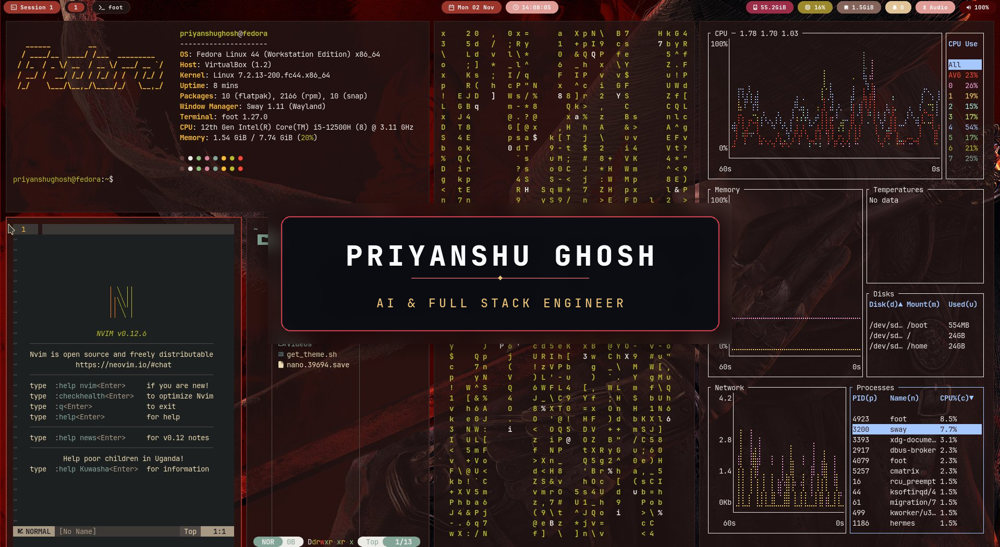
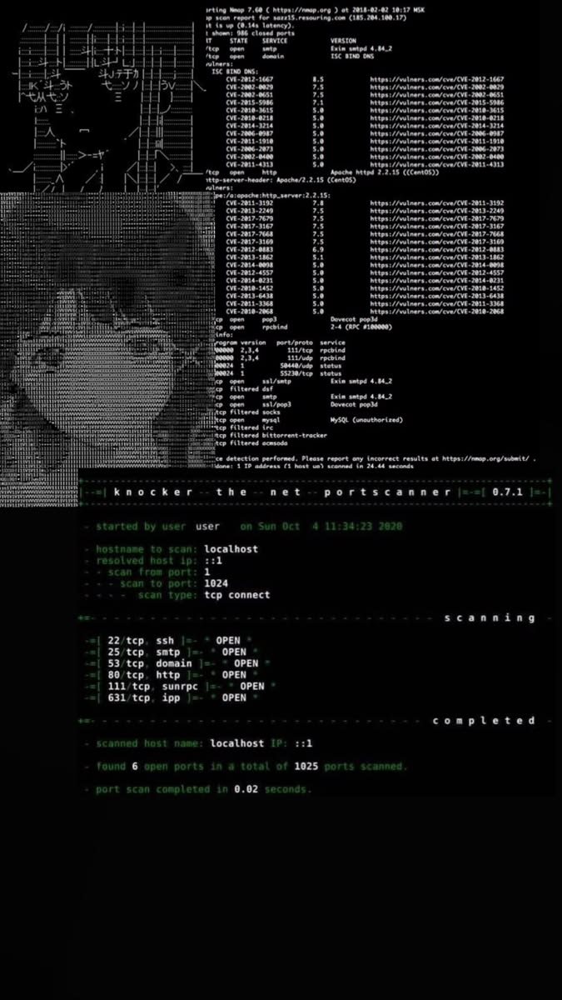

<div align="center">

<!-- ══════════════════════════════════════════════════════════════════ -->
<!--  HEADER BANNER                                                     -->
<!-- ══════════════════════════════════════════════════════════════════ -->



<br/>

<!-- ══════════════════════════════════════════════════════════════════ -->
<!--  TYPING TELEMETRY                                                 -->
<!-- ══════════════════════════════════════════════════════════════════ -->


<br/><br/>

<!-- ══════════════════════════════════════════════════════════════════ -->
<!--  HIGH-CONTRAST METRIC PILLS                                       -->
<!-- ══════════════════════════════════════════════════════════════════ -->

<a href="#featured-projects--systems"></a>
&nbsp;
<a href="#open-source-journey"></a>
&nbsp;
<a href="https://triagenet-frontend.onrender.com"></a>
&nbsp;
<a href="#honors--track-record"></a>
&nbsp;
<a href="#triagenet-v130"></a>

</div>

<br/>

<!-- ══════════════════════════════════════════════════════════════════ -->
<!--  EDITORIAL IDENTITY SECTION (WHO I AM // WHAT I DO // ABOUT)        -->
<!-- ══════════════════════════════════════════════════════════════════ -->



### WHO I AM &nbsp; 

- **Full Stack & Backend Developer** based in Jharkhand, India.
- Final year CSBS student at Asansol Engineering College (2023 - 2027).
- Focus on **Java (Spring Boot 3.3)** backends, distributed microservices, and applied AI tools.
- Comfortable building across the stack with Next.js, React, PostgreSQL, and Redis.

### WHAT I DO &nbsp; 

- **Emergency Healthcare Routing**: Built [TriageNet v1.3.0](https://github.com/PG300604/TriageNet), mapping 111 government hospitals across all 24 districts of Jharkhand for patient triage and 108 ambulance dispatch.
- **Distributed Systems**: Built [ShopFlow](https://github.com/PG300604/ShopFLow), an 8-microservice e-commerce backend with two-phase inventory holds to prevent overselling during checkout.
- **AI Automation**: Shipped [ZeroHour](https://github.com/PG300604/ZeroHour) in 24 hours at the Google × Coding Ninjas hackathon, converting unstructured deadline docs into scheduled Google Calendar events.
- **Testing & Quality**: Writing comprehensive unit/integration test suites (89 passing tests on TriageNet) and maintaining clean container vulnerability scans.

<br clear="all"/>
<br/>


### HOW I BUILD &nbsp; 

- **Practical Problem Solving**: I focus on software that solves real bottlenecks, such as coordinating hospital admissions during emergencies or preventing race conditions in flash sales.
- **End-to-End Ownership**: From designing database schemas and writing business logic to Dockerizing services and wiring up frontend dashboards.
- **Reliable by Default**: Prioritizing error handling, input validation, automated tests, and clear API boundaries before adding extra features.

### BEYOND CODE &nbsp; 

- **Problem Solving**: Regularly solving data structures and algorithms problems on [LeetCode](https://leetcode.com/u/priyanshughosh30/), focused on graphs, trees, and dynamic programming.
- **System Internals**: Reading about distributed consensus, database indexing, and Linux fundamentals.
- **Interests**: Customizing Linux desktop environments, experimenting with mechanical keyboards, and listening to electronic music.

<br clear="all"/>

<br/>

<!-- ══════════════════════════════════════════════════════════════════ -->
<!--  SOCIAL MATRIX (FRAMED TERMINAL GRID)                              -->
<!-- ══════════════════════════════════════════════════════════════════ -->

<div align="center">

<table align="center" border="0" cellspacing="0" cellpadding="10" style="border-collapse: collapse;">
  <thead>
    <tr>
      <th align="center" style="color: #c9d1d9; font-family: monospace; font-size: 13px;">LinkedIn</th>
      <th align="center" style="color: #c9d1d9; font-family: monospace; font-size: 13px;">X (Twitter)</th>
      <th align="center" style="color: #c9d1d9; font-family: monospace; font-size: 13px;">Instagram</th>
      <th align="center" style="color: #c9d1d9; font-family: monospace; font-size: 13px;">Gmail</th>
      <th align="center" style="color: #c9d1d9; font-family: monospace; font-size: 13px;">Portfolio</th>
      <th align="center" style="color: #c9d1d9; font-family: monospace; font-size: 13px;">GitHub</th>
      <th align="center" style="color: #c9d1d9; font-family: monospace; font-size: 13px;">LeetCode</th>
    </tr>
  </thead>
  <tbody>
    <tr>
      <td align="center" style="padding: 10px 14px;">
        <a href="https://www.linkedin.com/in/priyanshu-ghosh-/" title="LinkedIn"></a>
      </td>
      <td align="center" style="padding: 10px 14px;">
        <a href="https://x.com/PGhosh3006" title="X (Twitter)"></a>
      </td>
      <td align="center" style="padding: 10px 14px;">
        <a href="https://www.instagram.com/priyanshu30ghosh/" title="Instagram (@priyanshu30ghosh)"></a>
      </td>
      <td align="center" style="padding: 10px 14px;">
        <a href="mailto:priyanshughosh97@gmail.com" title="Gmail"></a>
      </td>
      <td align="center" style="padding: 10px 14px;">
        <a href="https://shipwithpriyanshu.vercel.app/" title="Portfolio Website"></a>
      </td>
      <td align="center" style="padding: 10px 14px;">
        <a href="https://github.com/PG300604" title="GitHub"></a>
      </td>
      <td align="center" style="padding: 10px 14px;">
        <a href="https://leetcode.com/u/priyanshughosh30/" title="LeetCode Profile"></a>
      </td>
    </tr>
  </tbody>
</table>

</div>

<br/>

<!-- ══════════════════════════════════════════════════════════════════ -->
<!--  3D ISOMETRIC CONTRIBUTION SKYLINE & TELEMETRY                     -->
<!-- ══════════════════════════════════════════════════════════════════ -->

### ENGINEERING METRICS & 3D SKYLINE &nbsp; 

<div align="center">

<picture>
  <source media="(prefers-color-scheme: dark)" srcset="./profile-3d-contrib/profile-night-view.svg" />
  <source media="(prefers-color-scheme: light)" srcset="./profile-3d-contrib/profile-green-animate.svg" />
  
</picture>

<br/><br/>


&nbsp;&nbsp;


<br/><br/>


</div>

<br/>

<!-- ══════════════════════════════════════════════════════════════════ -->
<!--  SKILL SET MATRIX                                                  -->
<!-- ══════════════════════════════════════════════════════════════════ -->

### SKILL SET &nbsp; 

<div align="center">


<br/><br/>

| Domain | Core Technologies |
|:---|:---|
| **Backend Development** | Java 21/17, Spring Boot 3.3, Spring Cloud Gateway, Spring Security, Hibernate/JPA, Maven |
| **Distributed Systems** | Microservices, Netflix Eureka, Two-Phase Stock Reservation, Redis Pub/Sub, REST APIs, OpenFeign |
| **Databases & Storage** | PostgreSQL, PostGIS (Geospatial), Redis, MySQL, Supabase, H2 |
| **AI & LLM Integration** | Gemini API, Prompt Orchestration, Structured Outputs, Server-Sent Events (SSE) Streaming |
| **Frontend & UI** | Next.js, React, TypeScript, Tailwind CSS, Vite, Leaflet |
| **DevOps & Infrastructure** | Docker, Git & GitHub Actions (CI/CD), Nginx, Linux, Vercel, Render |

</div>

<br/>

<!-- ══════════════════════════════════════════════════════════════════ -->
<!--  DEPLOYMENT STATUS MONITOR                                         -->
<!-- ══════════════════════════════════════════════════════════════════ -->

### DEPLOYMENT STATUS MONITOR &nbsp; 

<div align="center">

```
┌────────────────────────────────────────────────────────────────────────────────────────┐
│  [::]  PROJECT STATUS & DEPLOYMENT MONITOR                          [ STATUS: ONLINE ] │
├─────────────────────────┬──────────────┬─────────────────────────────┬─────────────────┤
│  SERVICE / SYSTEM       │  STATUS      │  CORE ARCHITECTURE          │  DEPLOYMENT     │
├─────────────────────────┼──────────────┼─────────────────────────────┼─────────────────┤
│  TriageNet Platform     │  v1.3.0 LIVE │  Java 17 · Next 16 · Redis  │  Render Cloud   │
│  ShopFlow Mesh          │  SHIPPED     │  8 Microservices · 2PC Lock │  Docker Cloud   │
│  ZeroHour AI            │  SHIPPED     │  Gemini AI · 4-Agent SSE    │  Firebase / Rwy │
│  RepoMind Analyzer      │  SUBMITTED   │  IBM Bob API · GitHub Bot   │  IBM Hackathon  │
│  SkyCheck PWA           │  SUBMITTED   │  Dexie.js · Edge Vision PWA │  Tata InnoVent  │
│  SkillShare             │  LIVE        │  Haversine Geo · Docker     │  Vercel Cloud   │
├─────────────────────────┼──────────────┼─────────────────────────────┼─────────────────┤
│  SHIPPED SYSTEMS: 7+    │  CI: 100%    │  ACTIVE REPOSITORIES: 10+   │  INTERNSHIP: YES│
└─────────────────────────┴──────────────┴─────────────────────────────┴─────────────────┘
```

</div>

<br/>

<!-- ══════════════════════════════════════════════════════════════════ -->
<!--  FEATURED PROJECTS WITH EXPANDABLE DETAIL CARDS                    -->
<!-- ══════════════════════════════════════════════════════════════════ -->


### FEATURED PROJECTS & SYSTEMS &nbsp; 

A selection of projects focusing on backend systems, distributed architectures, emergency healthcare routing, and web applications.

- **Live Deployments**: Active web applications deployed on Render, Vercel, and cloud VMs.
- **Distributed Design**: Multi-service architectures with service discovery, two-phase reservation locks, and Redis messaging.
- **Tested & Maintained**: Core algorithms implemented directly without external solver bloat, backed by automated test suites.

<br clear="all"/>
<br/>

<!-- ─── 1. TriageNet ─── -->

<details open id="triagenet-v130">
<summary>
  <b>TriageNet v1.3.0</b> &nbsp;|&nbsp; <code>PRODUCTION LIVE</code> &nbsp;|&nbsp; <code>111 Hospitals</code> &nbsp;|&nbsp; <code>89/89 Tests Passing</code>
  <br/>
  <sub>Emergency Healthcare Dispatch Platform and 108 Ambulance Routing</sub>
</summary>

<br/>

<table width="100%" style="border-collapse: collapse; border: 1px solid #30363d; background: #0d1117;">
  <tr>
    <td style="padding: 14px 18px; border-left: 4px solid #39d353;">
      <b>Purpose:</b> Healthcare emergency dispatch platform connecting <b>111 government hospitals across all 24 districts of Jharkhand</b> (including RIMS Ranchi, MGM Jamshedpur, SNMMCH Dhanbad, district hospitals, and community health centers) to streamline emergency intake, bed allocation, and ambulance routing.
      <br/><br/>
      <b>Key Metrics:</b>
      <br/>
      • <b>111 government hospitals</b> mapped across <b>24 districts</b> with actual road distance matrices<br/>
      • <b>89/89 automated tests passing</b> across unit and integration suites<br/>
      • <b>Real-time GPS telemetry</b> for ambulances streamed via Redis 7.2 pub/sub<br/>
      • <b>High emergency triage recall</b> validated on emergency medical benchmark datasets<br/>
      • <b>Clean container builds</b> with 0 CVEs on security scans
      <br/><br/>
      <b>Problem Solved:</b> In emergency trauma situations, hospital coordination often relies on manual phone calls. Delays in finding facilities with available ICU beds or specialists cost critical time during the golden hour.
      <br/><br/>
      <b>How It Works:</b> Implements pure Java algorithms for triage and routing without external solver dependencies: logistic acuity scoring, a wait-aging queue for triage priority, Kuhn-Munkres bipartite matching for bed allocation, and Dijkstra shortest-path calculations to assist ambulance drivers and emergency dispatchers.
      <br/><br/>
      <b>Stack:</b> Java 17 · Spring Boot 3.3.13 · Next.js 16.4.1 · Redis 7.2 · PostgreSQL 16 + PostGIS · Docker Compose · Nginx
      <br/><br/>
      <b>Direct Links:</b> &nbsp;
      <a href="https://triagenet-frontend.onrender.com"></a>
      &nbsp;
      <a href="https://github.com/PG300604/TriageNet/releases/tag/v1.3.0"></a>
      &nbsp;
      <a href="https://github.com/PG300604/TriageNet"></a>
    </td>
  </tr>
</table>

</details>

<br/>

<!-- ─── 2. AegisBrain ─── -->

<details open id="aegis-brain">
<summary>
  <b>AegisBrain</b> &nbsp;|&nbsp; <code>SHIPPED v0.1.0</code> &nbsp;|&nbsp; <code>Zero-Dependency Daemon</code> &nbsp;|&nbsp; <code>&lt; 50ms Recall · &le; 400 Tokens</code>
  <br/>
  <sub>Local Neural Memory Bus, Wake-Lock Caffeinate, and Telegram / WhatsApp Remote Control for Autonomous Coding Agents</sub>
</summary>

<br/>

<table width="100%" style="border-collapse: collapse; border: 1px solid #30363d; background: #0d1117;">
  <tr>
    <td style="padding: 14px 18px; border-left: 4px solid #38bdf8;">
      <b>Purpose:</b> Zero-overhead local neural memory bus and background daemon for AI coding agents (Antigravity, Claude Code, Codex, Cursor) replacing heavy log-parsing token waste with deterministic instant retrieval.
      <br/><br/>
      <b>Key Metrics &amp; Engineering Specifications:</b>
      <br/>
      • <b>&lt; 50ms retrieval latency</b> across multi-threaded SQLite WAL virtual tables via FTS5 inverted indexing<br/>
      • <b>&gt; 95% token reduction:</b> Bounded memory lookups require &lt; 100 tokens vs 25,000 to 60,000 tokens for traditional agent session-log crawling<br/>
      • <b>&le; 400 token deterministic context budget:</b> Workspace governor bounds git diffs, branch state, and commits to maximize LLM prompt-cache hit rates<br/>
      • <b>0 external runtime dependencies:</b> Operates strictly on Python standard library modules (<code>sqlite3</code>, <code>ctypes</code>, <code>http.server</code>, <code>urllib</code>)<br/>
      • <b>&lt; 25 MB RAM footprint</b> and &lt; 50ms cold boot time on host machine
      <br/><br/>
      <b>Core Features:</b>
      <br/>
      • <b>Native Caffeinate Wake-Lock:</b> Cross-platform idle prevention via Win32 <code>kernel32.SetThreadExecutionState</code> AwayMode pulse threads, macOS <code>caffeinate -i</code>, and Linux <code>systemd-inhibit</code>.<br/>
      • <b>Telegram &amp; WhatsApp Remote Bridge:</b> Remote shell execution, git workflow dispatch, artifact inspection, and safety shutdown right from mobile without public IP or port forwarding.<br/>
      • <b>Ephemeral Stealth Mode:</b> Zero-disk logging option bypassing disk writes for sensitive client projects.
      <br/><br/>
      <b>Stack:</b> Python 3.10+ · SQLite3 (WAL + FTS5) · Win32 ctypes · Telegram Bot API · Twilio WhatsApp API
      <br/><br/>
      <b>Direct Links:</b> &nbsp;
      <a href="https://github.com/PG300604/aegis-brain"></a>
      &nbsp;
      <a href="https://github.com/PG300604/aegis-brain#benchmarks"></a>
    </td>
  </tr>
</table>

</details>

<br/>

<!-- ─── 3. ShopFlow ─── -->

<details id="shopflow">
<summary>
  <b>ShopFlow</b> &nbsp;|&nbsp; <code>SHIPPED v1.0</code> &nbsp;|&nbsp; <code>8 Microservices</code> &nbsp;|&nbsp; <code>Independent Architecture</code>
  <br/>
  <sub>Distributed E-Commerce Backend with Two-Phase Stock Reservation</sub>
</summary>

<br/>

<table width="100%" style="border-collapse: collapse; border: 1px solid #30363d; background: #0d1117;">
  <tr>
    <td style="padding: 14px 18px; border-left: 4px solid #f0883e;">
      <b>Purpose:</b> Multi-vendor distributed e-commerce backend built to explore microservice coordination, service discovery, and concurrency control during flash sales.
      <br/><br/>
      <b>Key Metrics:</b>
      <br/>
      • <b>8 Spring Boot 3.3 microservices</b> communicating via REST and OpenFeign<br/>
      • <b>Two-phase reservation locks</b> preventing duplicate sales on the final unit<br/>
      • <b>Automated background sweeper</b> releasing abandoned cart holds after 15 minutes<br/>
      • <b>Netflix Eureka discovery</b> (<code>:8761</code>) with Spring Cloud Gateway and JWT auth forwarding
      <br/><br/>
      <b>Problem Solved:</b> High-concurrency flash sales frequently trigger inventory race conditions, resulting in oversold products or permanently locked items when shoppers abandon checkout midway.
      <br/><br/>
      <b>How It Works:</b> Handles inventory holds through a two-phase reservation state machine (PENDING to COMMITTED or RELEASED), scheduled background tasks to clean up stale holds, Stripe webhook verification for payments, and a React 18 storefront.
      <br/><br/>
      <b>Stack:</b> Java 17 · Spring Boot 3.3 · Spring Cloud · PostgreSQL · React 18 · TypeScript · Vite · Stripe · Docker
      <br/><br/>
      <b>Direct Links:</b> &nbsp;
      <a href="https://github.com/PG300604/ShopFLow/blob/main/docs/SYSTEM_DOCUMENTATION.md"></a>
      &nbsp;
      <a href="https://github.com/PG300604/ShopFLow"></a>
    </td>
  </tr>
</table>

</details>

<br/>

<!-- ─── 4. ZeroHour ─── -->

<details id="zerohour">
<summary>
  <b>ZeroHour</b> &nbsp;|&nbsp; <code>PRODUCTION LIVE</code> &nbsp;|&nbsp; <code>Shipped in 24h</code> &nbsp;|&nbsp; <code>Google × Coding Ninjas</code>
  <br/>
  <sub>Multi-Agent Deadline Organizer & Calendar Scheduling App</sub>
</summary>

<br/>

<table width="100%" style="border-collapse: collapse; border: 1px solid #30363d; background: #0d1117;">
  <tr>
    <td style="padding: 14px 18px; border-left: 4px solid #39d353;">
      <b>Purpose:</b> Task organizer built and deployed in 24 hours during the Google × Coding Ninjas hackathon to turn unstructured assignment files and syllabus sheets into actionable calendar events.
      <br/><br/>
      <b>Key Metrics:</b>
      <br/>
      • <b>Shipped in 24 hours</b> from idea to live deployment<br/>
      • <b>4-stage AI pipeline</b> for document extraction, prioritization, scheduling, and notifications<br/>
      • <b>Server-Sent Events (SSE)</b> streaming intermediate reasoning steps directly to the UI<br/>
      • <b>Gemini API integration</b> parsing syllabus PDFs and images with automatic Google Calendar slot allocation
      <br/><br/>
      <b>Problem Solved:</b> Students often have deadlines scattered across syllabus PDFs, chat messages, and images, leading to missed assignments and planning fatigue.
      <br/><br/>
      <b>How It Works:</b> Breaks schedule extraction into a 4-step pipeline (Planner, Prioritizer, Scheduler, Nudge) that streams progress to the client via SSE and syncs scheduled study blocks into Google Calendar.
      <br/><br/>
      <b>Stack:</b> React · Spring Boot · Gemini API · Google Calendar API · Firebase · Railway · SSE
      <br/><br/>
      <b>Direct Links:</b> &nbsp;
      <a href="https://zerohour-a84d3.web.app/"></a>
      &nbsp;
      <a href="https://github.com/PG300604/ZeroHour"></a>
    </td>
  </tr>
</table>

</details>

<br/>

<!-- ─── 4. RepoMind ─── -->

<details id="repomind">
<summary>
  <b>RepoMind</b> &nbsp;|&nbsp; <code>PRIZE WINNER · $100 REWARD</code> &nbsp;|&nbsp; <code>IBM Bob 2.0</code> &nbsp;|&nbsp; <code>GitHub Action Bot</code>
  <br/>
  <sub>Repository-Aware Pull Request Risk Analyzer and Review Bot</sub>
</summary>

<br/>

<table width="100%" style="border-collapse: collapse; border: 1px solid #30363d; background: #0d1117;">
  <tr>
    <td style="padding: 14px 18px; border-left: 4px solid #58a6ff;">
      <b>Purpose:</b> Code review assistant that evaluates pull requests by analyzing the repository dependency graph rather than looking at diff lines in isolation.
      <br/><br/>
      <b>Key Metrics:</b>
      <br/>
      • <b>IBM Bob 2.0 Hackathon Winner:</b> Selected among 20 winners for the $100 Participant Reward via lablab.ai<br/>
      • <b>Zero-touch CI integration</b> via drop-in <code>.github/workflows</code> Action<br/>
      • <b>3-tier automated risk scoring</b> (Low, Medium, High) with blast-radius breakdowns<br/>
      • <b>Auto-generated test stub suggestions</b> for code paths uncovered by the diff
      <br/><br/>
      <b>Problem Solved:</b> Reviewing PR diffs line-by-line often misses regressions introduced into dependent services, classes, or database queries elsewhere in the repo.
      <br/><br/>
      <b>How It Works:</b> Uses the IBM Bob API to traverse dependencies across the codebase, assesses the impact radius of changes, and automatically posts risk summaries with JUnit test stubs as GitHub PR comments.
      <br/><br/>
      <b>Stack:</b> Java 17 · Spring Boot 3 · IBM Bob API · GitHub Actions
      <br/><br/>
      <b>Direct Links:</b> &nbsp;
      <a href="https://github.com/PG300604/REPOMIND-IBM_BOB2.0_HACKATHON_PROJ"></a>
    </td>
  </tr>
</table>

</details>

<br/>

<!-- ─── 5. SkyCheck ─── -->

<details id="skycheck">
<summary>
  <b>SkyCheck</b> &nbsp;|&nbsp; <code>INNOVENT SUBMISSION</code> &nbsp;|&nbsp; <code>Offline-First PWA</code> &nbsp;|&nbsp; <code>Tata InnoVent 2026</code>
  <br/>
  <sub>Offline-First Visual Structural Inspection Progressive Web App</sub>
</summary>

<br/>

<table width="100%" style="border-collapse: collapse; border: 1px solid #30363d; background: #0d1117;">
  <tr>
    <td style="padding: 14px 18px; border-left: 4px solid #f0883e;">
      <b>Purpose:</b> Offline-first web application designed for field engineers inspecting industrial infrastructure (bridges, towers, pipes) in areas with poor or absent connectivity.
      <br/><br/>
      <b>Key Metrics:</b>
      <br/>
      • <b>Tata Technologies InnoVent submission</b><br/>
      • <b>Client-side image analysis</b> on live camera feeds<br/>
      • <b>Complete offline capability</b> with zero network requirement in the field<br/>
      • <b>Dexie.js IndexedDB storage</b> with automatic sync upon reconnection
      <br/><br/>
      <b>Problem Solved:</b> Field inspections of physical infrastructure often occur in remote areas where cloud-based tools cannot load or save data.
      <br/><br/>
      <b>How It Works:</b> Performs defect detection directly in the browser, stores high-resolution inspection logs and photos locally in IndexedDB, and automatically syncs records to PostgreSQL once internet access is restored.
      <br/><br/>
      <b>Stack:</b> React PWA · Dexie.js · Gemini Vision API · Spring Boot · PostgreSQL · Tailwind CSS
      <br/><br/>
      <b>Direct Links:</b> &nbsp;
      <a href="https://dist-five-gules-45.vercel.app/"></a>
      &nbsp;
      <a href="https://github.com/PG300604/SkyCheck"></a>
    </td>
  </tr>
</table>

</details>

<br/>

<!-- ─── 6. SkillShare ─── -->

<details id="skillshare">
<summary>
  <b>SkillShare</b> &nbsp;|&nbsp; <code>LIVE DEPLOYED</code> &nbsp;|&nbsp; <code>Haversine Geolocation</code> &nbsp;|&nbsp; <code>Docker Alpine</code>
  <br/>
  <sub>Location-Based Skill Exchange and Collaborator Matching Platform</sub>
</summary>

<br/>

<table width="100%" style="border-collapse: collapse; border: 1px solid #30363d; background: #0d1117;">
  <tr>
    <td style="padding: 14px 18px; border-left: 4px solid #39d353;">
      <b>Purpose:</b> Peer skill exchange application connecting students and developers nearby based on geographic proximity and complementary skill sets.
      <br/><br/>
      <b>Key Metrics:</b>
      <br/>
      • <b>Live deployment</b> on Vercel and containerized cloud environments<br/>
      • <b>Dynamic Haversine distance search</b> with automatic radius expansion (10km to 100km)<br/>
      • <b>Multi-stage Docker Alpine build</b> with optimized JRE runtime footprint<br/>
      • <b>OAuth2 + JWT authentication</b> via JWKS verification
      <br/><br/>
      <b>Problem Solved:</b> Remote learning lacks in-person accountability, while generic social meetups make it difficult to find collaborators with matching technical interests.
      <br/><br/>
      <b>How It Works:</b> Calculates geographic distances between users using the Haversine formula, automatically widening the search boundary if local matches are sparse, and ranks profiles based on skill complementarity.
      <br/><br/>
      <b>Stack:</b> Java · Spring Boot · Spring Security · React 19 · PostgreSQL · Docker · Vercel
      <br/><br/>
      <b>Direct Links:</b> &nbsp;
      <a href="https://skillshare-app-vercel-xv9i.vercel.app/"></a>
      &nbsp;
      <a href="https://github.com/PG300604/skillshare-app-vercel"></a>
    </td>
  </tr>
</table>

</details>

<br/>

<!-- ══════════════════════════════════════════════════════════════════ -->
<!--  OPEN SOURCE JOURNEY                                               -->
<!-- ══════════════════════════════════════════════════════════════════ -->

### OPEN SOURCE JOURNEY &nbsp; 

Upstream open-source contributions merged into production engines and developer infrastructure.

<br/>

<details open id="open-source-journey-a2a">
<summary>
  <b>a2a-hub (Agent-to-Agent Gateway)</b> &nbsp;|&nbsp; <code>UPSTREAM MERGED</code> &nbsp;|&nbsp; <code>AppSec Hardening · Spring Security · Caffeine</code>
  <br/>
  <sub>Enterprise Agent-to-Agent API Gateway: DoS mitigation, trusted proxy CIDR validation, and fail-fast Docker encryption boot validation</sub>
</summary>

<br/>

<table width="100%" style="border-collapse: collapse; border: 1px solid #30363d; background: #0d1117;">
  <tr>
    <td style="padding: 14px 18px; border-left: 4px solid #39d353;">
      <b>Repository:</b> <a href="https://github.com/oscarbol09/a2a-hub"><b>oscarbol09/a2a-hub</b></a> (Enterprise agent-to-agent gateway and orchestration hub).
      <br/><br/>
      <b>Accepted & Merged Contributions:</b>
      <br/>
      • <b>AppSec: IP Spoofing Prevention & Memory-Exhaustion DoS Hardening in RateLimitFilter (<a href="https://github.com/oscarbol09/a2a-hub/pull/37">PR #37</a> · Merged):</b> Hardened the core rate limiter against adversarial evasion and denial-of-service. Bounded bucket storage via Caffeine (<code>maximumSize + expireAfterAccess</code>) removing the memory exhaustion attack vector under flood conditions. Added strict <code>remoteAddr</code> verification against trusted proxy CIDRs before inspecting <code>X-Forwarded-For</code> headers to eliminate header spoofing. Enforced filter ordering by placing <code>ApiKeyAuthFilter</code> (<code>@Order(10)</code>) before <code>RateLimitFilter</code> (<code>@Order(20)</code>) to ensure invalid auth fails fast before allocating state, backed by comprehensive unit tests.
      <br/>
      • <b>Docker Compose Boot Encryption Key Crash Fix (<a href="https://github.com/oscarbol09/a2a-hub/pull/35">PR #35</a> · Merged):</b> Fixed a startup crash during <code>docker compose up</code> by scoping strict fail-fast validation to production/staging profiles instead of inverting <code>!isDevOrTest</code>. Added payload bounds checks, key entropy validation, and compound profile test coverage (<code>prod-us-east</code>, <code>aws-staging</code>).
      <br/><br/>
      <b>Stack:</b> Java 21 · Spring Boot · Spring Security · Caffeine Cache · Docker Compose · JUnit 5
      <br/><br/>
      <b>Direct Links:</b> &nbsp;
      <a href="https://github.com/oscarbol09/a2a-hub/pull/37"></a>
      &nbsp;
      <a href="https://github.com/oscarbol09/a2a-hub/pull/35"></a>
      &nbsp;
      <a href="https://github.com/oscarbol09/a2a-hub"></a>
    </td>
  </tr>
</table>

</details>

<br/>

<details open id="open-source-journey">
<summary>
  <b>Beacon Notification Engine</b> &nbsp;|&nbsp; <code>UPSTREAM MERGED</code> &nbsp;|&nbsp; <code>Spring Boot 4 · Java 21</code> &nbsp;|&nbsp; <code>XERJ Corpus Selection</code>
  <br/>
  <sub>Production-grade transactional notification engine with multi-channel provider failover</sub>
</summary>

<br/>

<table width="100%" style="border-collapse: collapse; border: 1px solid #30363d; background: #0d1117;">
  <tr>
    <td style="padding: 14px 18px; border-left: 4px solid #39d353;">
      <b>Repository:</b> <a href="https://github.com/AbdulmalikAlayande/beacon"><b>AbdulmalikAlayande/beacon</b></a> (Transactionally-safe notification system for Spring Boot).
      <br/><br/>
      <b>Accepted & Merged Contributions:</b>
      <br/>
      • <b>Provider Circuit Breaker (<a href="https://github.com/AbdulmalikAlayande/beacon/pull/21">PR #21</a> · Merged):</b> Implemented <code>DefaultProviderCircuitBreaker</code> in <code>core.resilience</code>. Built a thread-safe 3-state finite state machine (<code>CLOSED</code>, <code>OPEN</code>, <code>HALF_OPEN</code>) with per-provider state isolation and deterministic <code>Clock</code> injection. Prevents thread pool exhaustion and cascading latency during upstream provider downtime.
      <br/>
      • <b>Maven Library Packaging Fix (<a href="https://github.com/AbdulmalikAlayande/beacon/pull/22">PR #22</a> · Merged · Co-Author):</b> Resolved Spring Boot repackaging behavior on <code>beacon-api</code> so downstream modules can compile cleanly against installed artifacts.
      <br/>
      • <b>Selected for XERJ Corpus Hub:</b> Implementation selected for inclusion in the XERJ public Corpus Hub as an open reference solution for coding agents.
      <br/><br/>
      <b>Stack:</b> Java 21 · Spring Boot 4.0.6 · ConcurrentHashMap · Maven · JUnit 5
      <br/><br/>
      <b>Direct Links:</b> &nbsp;
      <a href="https://github.com/AbdulmalikAlayande/beacon/pull/21"></a>
      &nbsp;
      <a href="https://github.com/AbdulmalikAlayande/beacon/pull/22"></a>
      &nbsp;
      <a href="https://github.com/AbdulmalikAlayande/beacon"></a>
    </td>
  </tr>
</table>

</details>

<br/>

<!-- ══════════════════════════════════════════════════════════════════ -->
<!--  HONORS & TRACK RECORD                                             -->
<!-- ══════════════════════════════════════════════════════════════════ -->

### HONORS & TRACK RECORD &nbsp; 

<div align="center">

| Milestone / Event | Organization | Details | Year |
|:---|:---|:---|:---:|
| **IBM Bob 2.0 Hackathon Winner** | IBM & lablab.ai | **Winner ($100 Prize Award)** for RepoMind: PR dependency-graph risk analyzer bot | 2026 |
| **Open Source Upstream (a2a-hub)** | oscarbol09/a2a-hub | Merged AppSec IP-spoofing and DoS rate limit hardening ([PR #37](https://github.com/oscarbol09/a2a-hub/pull/37)) and Docker Compose boot crash fix ([PR #35](https://github.com/oscarbol09/a2a-hub/pull/35)) | 2026 |
| **AegisBrain Architecture & Launch** | Independent Build | Built local neural memory bus with SQLite WAL + FTS5 (<50ms recall, 95%+ token savings), Caffeinate, and WhatsApp bridge | 2026 |
| **Open Source Upstream (Beacon Engine)** | AbdulmalikAlayande/beacon | Merged core resilience circuit breaker ([PR #21](https://github.com/AbdulmalikAlayande/beacon/pull/21)) and build fix ([PR #22](https://github.com/AbdulmalikAlayande/beacon/pull/22)) | 2026 |
| **XERJ Corpus Hub Selection** | XERJ Org | Selected for public reference index: DefaultProviderCircuitBreaker implementation (Java 21) | 2026 |
| **TriageNet v1.3.0 Release** | Public Health Cloud | 111 government hospitals across 24 districts · 89 passing tests (100% CI Green) · Live on Render Cloud · 0 Trivy CVEs | 2026 |
| **ShopFlow 8-Microservices Architecture** | Independent Build | Built 8 Spring Boot microservices with two-phase inventory holds and Stripe payments | 2026 |
| **24-Hour Hackathon Ship** | Coding Ninjas × Google | ZeroHour: Built and deployed a 4-agent task organizer in 24 hours | 2026 |
| **Tata Technologies InnoVent** | Tata Technologies | SkyCheck PWA: Offline-first structural defect inspection with IndexedDB sync | 2026 |
| **Software Engineering Simulation** | JPMorgan Chase (Forage) | Kafka event streaming, REST API integration, and H2 database architecture | 2026 |
| **Academic Standing (SGPA 8.83 · CGPA 8.05)** | Asansol Engineering College | B.Tech in Computer Science & Business Systems (CSBS, 2023 - 2027) | 2027 |

</div>

<br/>

<!-- ══════════════════════════════════════════════════════════════════ -->
<!--  ENGINEERING HIGHLIGHTS                                            -->
<!-- ══════════════════════════════════════════════════════════════════ -->

### ENGINEERING HIGHLIGHTS &nbsp; 

<div align="center">

| Focus Area | Practical Implementation in Projects |
|:---|:---|
| **Fast Prototyping & Shipping** | Shipped a multi-agent scheduling app in 24 hours ([ZeroHour](https://github.com/PG300604/ZeroHour)) and engineered an 8-service microservice backend ([ShopFlow](https://github.com/PG300604/ShopFLow)) from scratch. |
| **Security & Best Practices** | Implemented Ed25519 digital signature baselines, HttpOnly cookie authentication, and verified container builds with 0 Trivy CVEs ([TriageNet](https://github.com/PG300604/TriageNet)). |
| **Distributed Systems** | Practical experience with two-phase inventory holds, Netflix Eureka service discovery, and Redis 7.2 pub/sub messaging with TTL keys. |
| **Testing & CI/CD** | 89 automated tests on TriageNet with clean GitHub Actions pipelines running on both Linux and Windows environments. |

</div>

<br/>

<!-- ══════════════════════════════════════════════════════════════════ -->
<!--  CURRENT FOCUS & LEARNING                                          -->
<!-- ══════════════════════════════════════════════════════════════════ -->

### CURRENT FOCUS & LEARNING &nbsp; 

<div align="center">

| Domain | Focus & Toolchain |
|:---|:---|
| **Event Streaming** | Deepening practical experience with Apache Kafka, consumer groups, partition management, and change data capture (Debezium). |
| **AI Systems & Tooling** | Developing workflows using Model Context Protocol (MCP), structured schemas, and automated agent loops. |
| **Container Orchestration** | Deploying services with Kubernetes (K8s), Helm charts, and Ahead-of-Time compilation via GraalVM. |

</div>

<br/>

<!-- ══════════════════════════════════════════════════════════════════ -->
<!--  CONTRIBUTION SNAKE ANIMATION                                      -->
<!-- ══════════════════════════════════════════════════════════════════ -->

### CONTRIBUTION ACTIVITY &nbsp; 

<div align="center">

<picture>
  <source media="(prefers-color-scheme: dark)" srcset="https://raw.githubusercontent.com/PG300604/PG300604/output/github-contribution-grid-snake-dark.svg" />
  <source media="(prefers-color-scheme: light)" srcset="https://raw.githubusercontent.com/PG300604/PG300604/output/github-contribution-grid-snake.svg" />
  
</picture>

</div>

<br/>

<!-- ══════════════════════════════════════════════════════════════════ -->
<!--  FOOTER / CONTACT MATRIX                                           -->
<!-- ══════════════════════════════════════════════════════════════════ -->

<div align="center">


<br/><br/>

<a href="https://shipwithpriyanshu.vercel.app/"></a>
&nbsp;
<a href="https://www.linkedin.com/in/priyanshu-ghosh-/"></a>
&nbsp;
<a href="mailto:priyanshughosh97@gmail.com"></a>
&nbsp;
<a href="https://leetcode.com/u/priyanshughosh30/"></a>
&nbsp;
<a href="https://x.com/PGhosh3006"></a>
&nbsp;
<a href="https://www.instagram.com/priyanshu30ghosh/"></a>

<br/><br/>


<div align="left">

### GET IN TOUCH &nbsp; 

- **Location**: Jharkhand, India
- **Availability**: Open to Software Engineering (SDE) and Backend Internships
- **Email**: [priyanshughosh97@gmail.com](mailto:priyanshughosh97@gmail.com)
- **Profiles**: [LinkedIn](https://www.linkedin.com/in/priyanshu-ghosh-/) · [LeetCode](https://leetcode.com/u/priyanshughosh30/) · [GitHub](https://github.com/PG300604)
- **Socials**: [@PGhosh3006](https://x.com/PGhosh3006) on X · [@priyanshu30ghosh](https://www.instagram.com/priyanshu30ghosh/) on Instagram

</div>

<br clear="all"/>
<br/>

</div>
